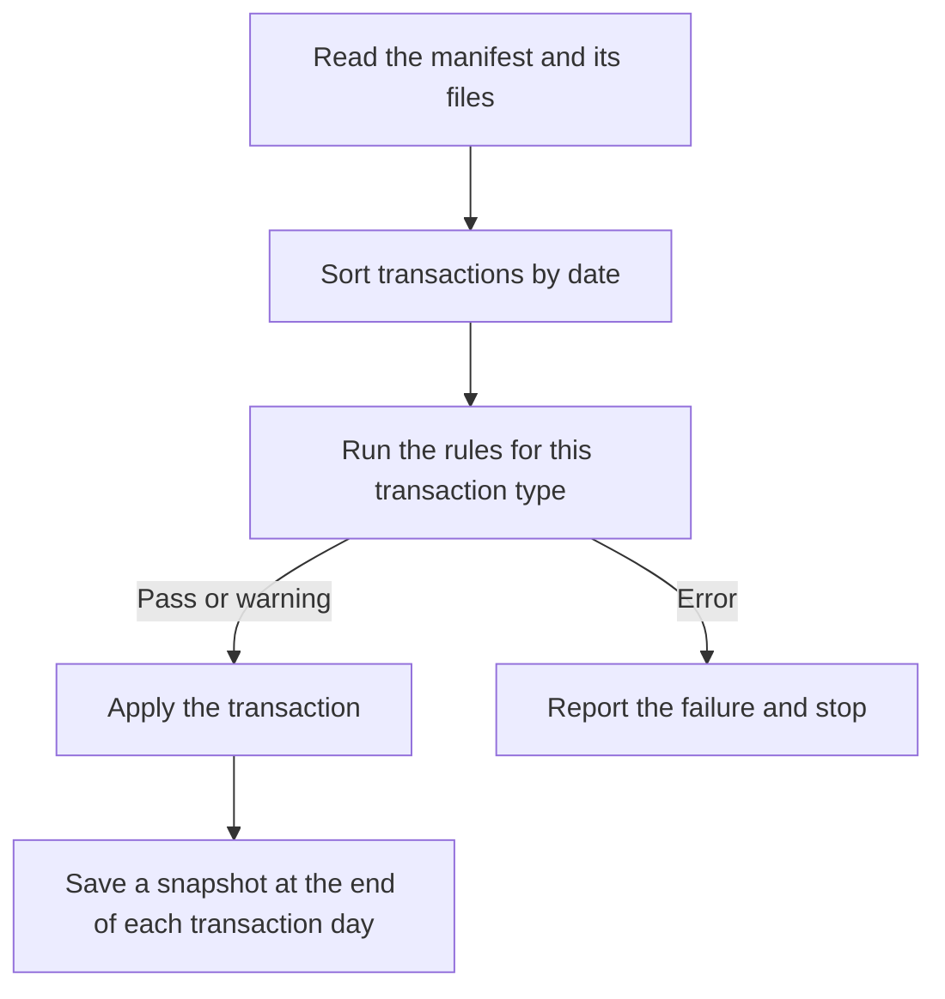

# Open Cap Table Format (OCF) Tools

OCF defines how a cap table export records issuers, stakeholders, securities and events such as grants, transfers and cancellations. **OCF-Tools checks whether those records follow the rules defined in this repository.** You can read a rule, run its tests, and check an export against it.

For example, a warrant issuance can contain a correctly formatted `stakeholder_id` of `"sh1"` even when the export has no stakeholder with that ID. The `stakeholder-exists` rule checks the stakeholder records. It passes when it finds `sh1` and reports the missing ID when it does not. [Rule](ocf_validator/validators/checks.ts) · [Checks for warrant issuance](ocf_validator/validators/warrant/tx_warrant_issuance.ts) · [Passing and failing tests](tests/warrantValidators.test.ts)

## Try a sample

Use the Node.js version in `.nvmrc`. Run these commands from the repository root.

```sh
npm ci
npx ts-node -e "import { ocfValidator } from './index'; console.log(ocfValidator('testing_scripts/testPackage').result)"
```

The sample issues an option grant and starts its vesting on June 1, 2019. Both transactions pass the current checks. To check another export, pass the folder containing `Manifest.ocf.json`.

Run the warrant tests to see the same issuance checked with and without a matching stakeholder.

```sh
npm test -- tests/warrantValidators.test.ts -t "warrant issuance validity"
```

| Task | Function | Result |
| --- | --- | --- |
| Read the records | `readOcfPackage(folder)` | The manifest and the records from each file it lists. |
| Check a package | `ocfValidator(folder)` | A summary in `result`, problems in `findings`, stock checks in `report`, and daily `snapshots`. |
| See holdings on a date | `ocfSnapshot(folder, "2019-06-01")` | The latest snapshot on or before that date, or `null` if none exists. |

## How validation works



The reader loads the package once per validation. For transactions on the same date, the validator uses a fixed order by type. The XState machine uses `TX_DESCRIPTORS` to choose a validator and update the outstanding securities. For example, issuing a warrant adds it to the cap table and cancelling it removes it. [Package reader](read_ocf_package/index.ts) · [Transaction order](ocf_validator/index.ts) · [Transaction rules](ocf_validator/ocfMachine.ts) · [Snapshot fields](ocf_validator/eod.ts)

## Limits on main

- **Rule coverage varies.** Stock, warrant, convertible and equity compensation transactions have checks. Vesting events receive only a check for an earlier removal. The validator skips stock plan pool accounting and does not check every file against the OCF schema. “Appears valid” means the package passed the implemented checks.
- **A failure cuts the history short.** An error stops validation at that transaction. Warnings let it continue. If you request a snapshot for a later date, you can get the last completed day before the error. Read `result` and `snapshots` together when the date matters.
- **Run from source.** `npm run build` checks types without writing JavaScript to `dist/`. Use the source entry point in the example above. Run `npm test` for the test suite.

## Roadmap

| Status | Goal |
| --- | --- |
| In review | Keep checking unrelated securities after an error. Show which later checks depend on the failed transaction, and flag stock plans that grant more shares than they reserve. [Failure reporting](https://github.com/Open-Cap-Table-Coalition/OCF-Tools/pull/242) · [Stock plan limits](https://github.com/Open-Cap-Table-Coalition/OCF-Tools/pull/244) |
| Proposed | Order same-day transactions by what they reference, so an issuance runs before a transaction that uses it. Check records such as stakeholders and vesting terms before processing transactions that rely on them. [Transaction order](https://github.com/Open-Cap-Table-Coalition/OCF-Tools/issues/232) · [Reference checks](https://github.com/Open-Cap-Table-Coalition/OCF-Tools/issues/234) |
| Proposed | Check share limits by stock class and issuer, validate vesting schedules, and publish a versioned npm package. [Share limits](https://github.com/Open-Cap-Table-Coalition/OCF-Tools/issues/225) · [Project roadmap](https://github.com/Open-Cap-Table-Coalition/OCF-Tools/discussions/145) |

The contributor guide covers the validator changes in review and gives examples of how to write rules, tests and PR descriptions. [Contributor guide](AGENTS.md)
