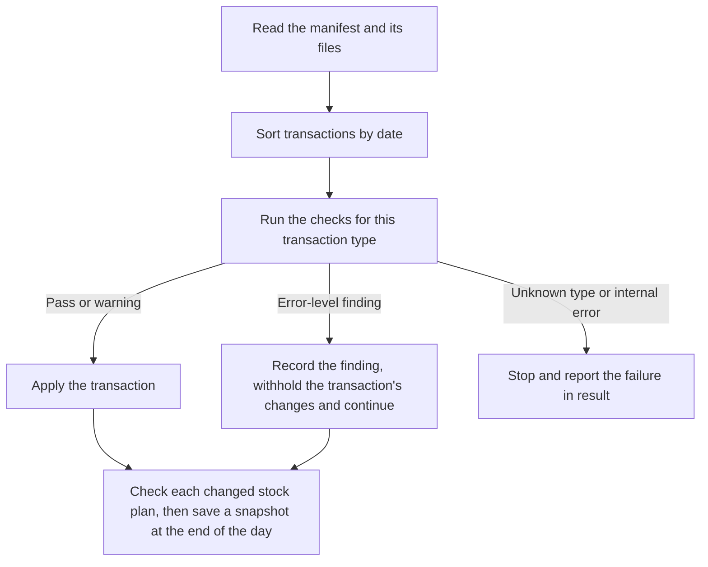

# Open Cap Table Format (OCF) Tools

OCF defines how a cap table export records issuers, stakeholders, securities and events such as grants, transfers and cancellations. **OCF-Tools checks whether those records follow the rules defined in this repository.** You can read a rule, run its tests, and check an export against it.

For example, a warrant issuance can contain a correctly formatted `stakeholder_id` of `"sh1"` even when the export has no stakeholder with that ID. The `stakeholder-exists` rule checks the stakeholder records. It passes when it finds `sh1` and reports the missing ID when it does not. [Rule](ocf_validator/validators/checks.ts) · [Checks for warrant issuance](ocf_validator/validators/warrant/tx_warrant_issuance.ts) · [Passing and failing tests](tests/warrantValidators.test.ts)

## Try a sample

Use the Node.js version in `.nvmrc`. Run these commands from the repository root.

```sh
npm ci
npx ts-node -e "import { ocfValidator } from './index'; console.log(ocfValidator('testing_scripts/testPackage').result)"
```

The sample issues an option grant and starts its vesting on June 1, 2019. Both transactions pass the current checks. To check another export, pass the folder containing `Manifest.ocf.json`.

Run the warrant tests to see the same issuance checked with and without a matching stakeholder.

```sh
npm test -- tests/warrantValidators.test.ts -t "warrant issuance validity"
```

| Task | Function | Result |
| --- | --- | --- |
| Read the records | `readOcfPackage(folder)` | The manifest and the records from each file it lists. |
| Check a package | `ocfValidator(folder)` | A summary in `result`, problems in `findings`, daily `snapshots`, and each security's history in `nodes`. |
| List the issuances on a date | `ocfSnapshot(folder, "2019-06-01")` | The latest snapshot on or before that date, or `null` if none exists. Each row repeats the issuance's recorded quantity. It is not a remaining balance (see the limits below). |
| List one family's outstanding issuances | `outstanding(nodes, "stockIssuances")` | The outstanding issuances of one family, in their original order. Pass the `nodes` from `ocfValidator`. |

## How validation works



The reader loads the package once per validation. For transactions on the same date, the validator uses a fixed order by type. The XState machine uses `TX_DESCRIPTORS` to choose the checks and update the outstanding securities. For example, issuing a warrant adds it to the cap table and cancelling it removes it. A transaction under one of the older `TX_PLAN_SECURITY_*` names is validated as the equity compensation transaction it stands for. [Package reader](read_ocf_package/index.ts) · [Transaction order](ocf_validator/index.ts) · [Transaction table](ocf_validator/validators/index.ts) · [State machine](ocf_validator/ocfMachine.ts) · [Snapshot fields](ocf_validator/eod.ts)

Stock, convertible, warrant, equity compensation and stock plan checks report findings, as does the earlier-removal check on other transactions, such as vesting. When one of these checks fails at error level, the validator withholds that transaction's changes and marks the fields it would have written as unreliable. A later check that needs one of those fields reports a blocked finding instead of guessing. Independent checks still run. A check that throws is recorded as a failed error finding in the same way, and the remaining checks still run.

The day-end stock plan check is different. It records a finding and withholds nothing. A grant that takes a plan over its reserve stays in the plan's drawn total, and no field is marked unreliable, so don't assume an over-limit grant was withheld.

A failed stock check does not stop the run. It records findings in the same way as the other checks. Only three things stop a run: a transaction with an unknown type, an error thrown outside a check, and a transaction whose date or type isn't a string. The last one stops the run before the first transaction is processed.

Stock quantity checks add decimal share quantities exactly. A reissuance with an omitted or null `split_transaction_id` must have results that add up to the original quantity. A named split must be a stock class split with the reissuance's date and the original stock's class.

For the rules the validator applies and the corner cases settled so far, see [Validation rules and corner cases](docs/validation-rules.md).

### What `ocfValidator` returns

- `result` states whether the package appears valid. A completed run counts failed errors, blocked checks and warnings separately. If the run stops early, `result` identifies the transaction and the failure.
- `findings` lists each check's `severity` (`error` or `warning`), `outcome`, `check` ID, `message` and `subject` (an `object_type` and `id`). A `failed` finding reports a problem the check found. A `blocked` finding lists the earlier failures that caused it in `roots`. Warnings allow the transaction's changes. To group findings, use `check` and `subject`, plus `date` for day-end checks, and keep every message in each group.
- Stock checks report through `findings`. The `report` and `lastErrorFindings` fields no longer exist, so select a stock transaction's findings by its `subject` and the `check` ID. A check can produce several messages, such as one for each legend or resulting security that fails. A failed stock check can block a later check that reads the same security, and unrelated securities continue through the run. A stock issuance that reuses a security ID produces a finding that names the original issuance or the earlier removal.
- `snapshots` holds the cap table at the end of each transaction day the run completed. A row's optional `defects` lists the causes of uncertainty under `lifecycle` or `issuance`. A failed first issuance appears as a row that contains only its defects. Each snapshot also lists the plans under `stockPlans`, with decimal strings for `drawn` and, when known, `reserved`. Either total can have its own `defects` entry.
- `nodes` holds each security's issuance and lifecycle, including removed securities. Each field records its last writer and any defects. A security ID can be issued only once across all four families. `nodes.plan` holds the current pool totals by plan ID.

```js
const { ocfValidator, outstanding } = require("ocf-tools");

const { nodes } = ocfValidator(ocfPackageFolderDir);
const stock = outstanding(nodes, "stockIssuances");
```

### Stock plan shares

A plan starts with its initial reserve and zero drawn shares. An adjustment replaces the reserve. A grant or stock issuance that names the plan draws shares once. For example, cancelling 40 of a 100-share grant and issuing a 60-share balance leaves 100 drawn. An explicit return of 40 brings that total to 60. The source allowance follows the security across all returns, even when a return credits a successor plan, so a successor can have a negative drawn balance. A transaction that names a plan missing from the package creates a plan row with an unknown reserve.

At the end of each day, the `pool-not-exceeded` check compares drawn shares with the reserve for each plan whose totals changed that day. The finding identifies the plan (`STOCK_PLAN`) and the date. It does not fail or withhold any grant. A defect on either total blocks the check. The check is skipped when the reserve is unknown. A valid adjustment clears reserve defects because it replaces the full reserve. Drawn shares are a running total and keep earlier defects. [Pool check](ocf_validator/validators/stock_plan/pool.ts)

For a worked example of a grant, a partial cancellation, and a return to the pool, see [How the validator counts stock plan shares](docs/stock-plans.md).

## Limits on main

- **Rule coverage varies.** Stock, warrant, convertible, equity compensation and stock plan pool transactions have checks. Vesting events and other transactions receive only a check for an earlier removal. Share limits for a stock class or the issuer, vesting terms and other reference records are not checked, and the validator does not check every file against the OCF schema. “Appears valid” means the package passed the implemented checks.
- **Some failures still stop the run.** An unknown transaction type or an error thrown outside a check stops validation at that transaction, and `result` names it. After that stop, `ocfSnapshot` returns the last day completed before it, even for a later date, and does not say so. A transaction whose date or type isn't a string stops the run before it starts, so there are no snapshots and `ocfSnapshot` returns `null`. Errors from checks are recorded in `findings` and validation continues, so read `result` and `findings` together.
- **Package-loading failures throw.** Missing files or invalid JSON cause `readOcfPackage`, `ocfValidator` and `ocfSnapshot` to throw instead of returning a result. Callers must handle these exceptions separately.
- **Snapshot quantities are the issued quantities.** `ocfSnapshot` and `snapshots` copy the quantity from each stock and equity compensation issuance. An exercise or release of an equity compensation grant does not reduce it, so a fully exercised grant still appears at its issued quantity until something removes it. Vesting does not change a row. Treat a snapshot as a list of the issuance records that are still outstanding, not as remaining holdings. Convertible and warrant rows show a purchase price and no quantity.
- **Not published yet.** The package is not on npm. Run it from source as shown above, or link it as described below.

## Use it from another project

Run these commands in the OCF-Tools checkout. The build type-checks the source, and the next command writes the JavaScript the linked package uses.

```sh
npm ci
npm run build
npm exec -- tsc --noEmit false --allowImportingTsExtensions false --noCheck
npm link
```

In the project that uses OCF-Tools, run `npm link ocf-tools`. Then add `const { readOcfPackage, ocfValidator, ocfSnapshot, outstanding } = require("ocf-tools");` to the file that calls it.

## Roadmap

| Status | Goal |
| --- | --- |
| Proposed | Order same-day transactions by what they reference, so an issuance runs before a transaction that uses it. Check records such as stakeholders and vesting terms before processing transactions that rely on them. [Transaction order](https://github.com/Open-Cap-Table-Coalition/OCF-Tools/issues/232) · [Reference checks](https://github.com/Open-Cap-Table-Coalition/OCF-Tools/issues/234) |
| Proposed | Track securities, stock classes, plans and the issuer as a dependency graph, so an error reaches every record that relies on it and shares are checked against each class's and the issuer's authorized total. Validate vesting schedules and publish a versioned npm package. [Dependency graph and share limits](https://github.com/Open-Cap-Table-Coalition/OCF-Tools/issues/225) · [Project roadmap](https://github.com/Open-Cap-Table-Coalition/OCF-Tools/discussions/145) |

The contributor guide explains how to write rules, tests and PR descriptions for the validator. [Contributor guide](AGENTS.md)
